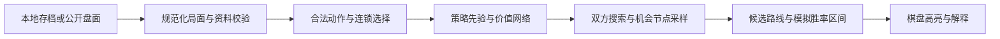

# 持续训练与局面教练

目录修订4已修正九张大名左槽，旧实验目录的目录哈希不再匹配；请另建输出目录及教师数据，不能沿用旧模型续训。新增的 BGA 观察导入与终局计分验证见 [bga-import.md](bga-import.md)，它仍不是可执行本地存档，不能传给本页的模型分析入口。

从玩家昵称或链接到回放、已核对选牌决策与模型微调的入口见 [BGA训练工作流](bga-training-workflow.md)。目前真人数据只监督起始选牌策略，未接入完整放骰连锁或BGA对局价值标签。

2026-11-13：r8已停止并保留；r9用家臣晋升、武士乘分与资源准备度作为可调先验，重新生成 `guide-r9`。正式输出为 `continuous-r9-full`；本机 `continuous-r9` 是已完成的两代小预算试验，配置不同，不能用正式配置续跑。`rewardVersion=own-final-score-v1`、`featureVersion=public-decisions-v4` 与 `setupVersion=tile-inventory-v3` 共同绑定数据及模型。教师最高50分，小预算模型训练席位最高38分；选模评估未晋级，详见 [r9实验](ai-r9-experiment.md)。侧栏配置仍保留旧冠军，这次没有自动部署新模型。

奖励 `z=自身终局分数/80`，80只作归一化，不封顶，也不以胜负替代得分。线性价值头可以学习80分以上；七分项辅助头学习即时分、钱印、资源、家臣、武士、园丁、时间，不改变实际奖励。教师样本的模仿权重为 `1 + min(1.5, max(0, finalScore - 30)/40)`，保留普通局。60–80分是观察目标，当前没有达到该水平的证据。日志查看器显示训练候选均分、最高分、分项及≥60/80/100比例。

正式训练与评估仅在完整动作根节点搜索，网络与攻略交错提名4个候选，每候选2个共同机会样本，预算120次原子决策/8次放骰。达到预算时先完成当前连锁；最多额外推进160次选择，仍未完成则记录失败，不伪造零分。截断估值为引擎阶段分加公开的家臣/武士交叉贡献与资源准备潜力；终局潜力严格归零。续行仍由攻略主导（小概率探索次优），没有使用网络价值头估叶。当前已公开骰子保持，未知补牌、未来骰子及缺失的时间先后关系独立抽样。它不是完整MCTS，不能保证最优；小预算试验使用2×1、40/4。`data/ai-search-deep.json` 提供8×4、300/18研究预算，尚未实际验证，不建议直接长期运行。

r9每代与攻略和同编码的当前冠军交换座位评估；双方神经网络使用相同搜索预算。旧固定对手与当前编码、奖励契约不兼容，因此 `frozenOpponent` 设为 `null`。后续若增加固定对手，须使用同编码及匹配目录、启发式指纹的检查点；这些评估仅用于选模，不是最终保留测试集。

按用户确认，继续以当前 `local-practice-v1` 为训练目标，不在这批改动中扩展正式摆设规则。卡牌数值仍由 JSON 配置管理；数据变化必须创建新的训练目录。训练变强和训练时间增长是两回事，本项目不承诺仅靠连续运行就达到强棋力。

## 已实现的循环

`scripts/train-loop.py` 使用 `data/ai-training-loop.json`：

1. 载入完整教师数据，按整局划分训练/验证，模仿预热一次。
2. 每代追加32局终局奖励训练，按四局节奏混合共享网络自我对弈、攻略、历史模型；历史/攻略对局轮换座位。
3. 每完成一局原子保存模型、优化器、Torch随机状态、已用种子。完整经验按局压缩保存；中途失败的局不计作有效训练。
4. 每代用16个新开局交换座位，分别比较候选对冠军、候选对攻略、冠军对攻略，共96局选模对局。
5. 在相同新开局与攻略换座比较，候选平均自身终局分数至少比冠军高0.25分才更新冠军。胜率仍报告，得分是当前选模目标；默认最少16对开局，小样本冒烟不晋级。
6. 无论是否晋级，最新候选继续探索，冠军单独保留。历史对手池保留最近6个晋级模型。遇到错误停止并保留检查点，不无限重试。

门槛属于工程选模判据，不能证明棋力显著改善。选模评估会影响后续对手池，不能再宣传为最终独立测试集；正式比较另留从未用于选模的一次性测试集。不同代使用不同种子，评估开局不进入训练。

目前训练是小型 on-policy actor-critic。经验保存了公开特征、合法候选、实际动作及自身终局分数标签，**没有反复重用旧经验进行优化**；搜索有效时实际采样为90%搜索分布加10%网络分布，对此混合分布求对数更新，并加入搜索策略蒸馏。未来使用经验回放时必须加入正确的行为概率、重分析或离策略修正。不能直接把自己的动作当成最优标签反复模仿。

## 如何一直运行

双击仓库根目录的 `查看AI训练日志.cmd`，即可打开每2秒刷新的独立查看窗口，显示累计平均/最高分、60/80/100分比例、七分项、最近10条训练记录、搜索耗时/失败及价值/分项MSE。关闭窗口或按 Ctrl+C 只退出查看；每局结束后分数才更新，无需重启训练或构建。

命令行也可运行 `node scripts/watch-ai.mjs --once` 查看一次，或加 `--raw` 查看原始JSON日志。默认目录优先读取当前副本 `data/ai-training-loop.json` 的 `outputDirectory`，旧分支缺少该项时回退侧栏配置；可用 `--directory`、`--log`、`--error-log` 覆盖文件位置，`--interval` 设置1–60秒刷新间隔。启动器与 `scripts/watch-ai.mjs`、`src/ui/StringTable.js`、训练及侧栏配置须按仓库布局一起复制，另需Node和该副本本机训练输出；不依赖盘符、分支名或构建目录。

从仓库根目录运行；需要已有 `.local/ai-venv`、Node及配套脚本，无须构建：

```powershell
# 新版编码的数据必须重新生成；命令拒绝覆盖已有输出。
node scripts/generate-training-data.mjs --games 32 --weights data/ai-heuristic-r9.json --out .local/ai/guide-r9.jsonl.gz --prefix r9-formal

# 默认持续运行；不需要联网，也不需要打开网页。
.\scripts\train-ai.ps1

# 查看最后保存的状态。phase是持久化快照，机器断电后不代表进程仍活着。
.\scripts\train-ai.ps1 -Action Status

# 在另一个终端请求停止，当前完整对局结束后退出。
.\scripts\train-ai.ps1 -Action Stop

# 重启电脑后再运行同一命令，自动继续；停止标记会由启动器清除。
.\scripts\train-ai.ps1

# 只跑到总第2代，用于有限时间验证。
.\scripts\train-ai.ps1 -Generations 2
```

`-Generations 0` 是持续模式；计算机休眠、关机时没有计算，重新执行命令才恢复。没有安装开机任务、系统服务或云计算作业。前台可用 Ctrl+C 请求停止；强制结束最多丢失正在执行但尚未写检查点的一局。预热中断会从头预热；选模评估中断会重做该份未完成报告。

同一输出目录由系统文件锁保护，防止两个进程同时写模型。输出由配置的 `outputDirectory` 指定，当前默认 `.local/ai/continuous-r9-full/`：

| 文件 | 用途 |
|---|---|
| `loop-state.json` | 当前代、阶段、最近检查点、冠军、历史对手、已用评估种子 |
| `initial/imitation.pt` | 首次预热快照 |
| `generation-*/candidate.pt` | 候选、优化器和完整对局恢复状态 |
| `generation-*/candidate.pt.decisions.jsonl` | 双方逐步选择、前三候选、策略/采样熵、搜索结果和动作边界诊断 |
| `generation-*/candidate.pt.progress.json` | 该代每局损失、分项、梯度和搜索统计；恢复时累积并按种子去重 |
| `generation-*/experience/` | 每局压缩经验及完整性清单 |
| `generation-*/evaluation.json` | 候选对冠军与攻略的选模报告 |
| `generation-*/champion-evaluation.json` | 相同开局下冠军对攻略的基线 |
| `generation-*/result.json` | 晋级或拒绝晋级的原因 |
| `STOP` | 下个对局边界停止的请求 |

配置的 `threads` 默认为2，当前PyTorch为CPU版。`maxDiskGB` 默认4，输出目录达到上限后在对局边界停止；这是软上限，单局写入和预热可能超过一点。脚本不自动删除旧模型。数据输入文件不在输出目录内，其空间不计入这个限制。可调整游戏数、评估数、阈值、线程和存储预算；为避免在中断恢复时改变实验含义，改配置后使用新的 `-OutputDirectory`。

`input`、`catalog`、`weights`、`initialCheckpoint`、配置内 `outputDirectory` 的相对路径以仓库为基准，配置文件和命令行 `-OutputDirectory` 由调用方指定。换分支需一起复制 `scripts/`、`src/`、`data/` 及依赖，另安装Python环境并提供本机教师数据；无需固定盘符、分支名、远端URL或 `dist/`。

卡牌、编码、启发式版本或输入清单改变时，原目录拒绝继续。`encoderHash` 绑定特征、环境、高分估值和攻略源码，避免漏改版本名后误载旧权重。修改这些文件后须重新生成教师数据并另建实验目录。旧文档中的v1/v2/r4/r8路径只供历史追踪。

## 数据为什么会更有用

扩大数据分三个层次：

- **开局覆盖**：增加不同种子的城堡、花园、训练面、起始牌和骰子，不只是相同开局重复走。
- **行为覆盖**：攻略、共享网络和历史对手产生不同路线，网络动作使用采样探索；记录亏资源、错失灯笼、对手抢占等失败局面。
- **标签质量**：用自身终局得分训练，并把有限路线比较得到的动作分布蒸馏给网络；信用分配和搜索预算仍有限，不能只增加低质量随机局。

以后可以单独扩大教师数据，例如改输出路径生成128局；教师训练仍只在新实验初始化时读取。连续循环主要扩大的是自我对弈经验。局数应按吞吐、独立对手表现和错误率逐步增加，不能预先保证几千局就足够强。

## 本批补全的编码

`public-decisions-v4` 继续相对当前行动者编码，并保留语义动作特征：

- 当前状态2357维、候选160维；旧2345维之后追加双方各6个公开结构特征：城内家臣、武士价值及乘积、城门家臣、晋升/谒见资源准备度。
- 双方每个家臣的具体层、房间及顶层槽位，避免同层人数相同却行动价值不同的局面混淆。
- 放置区比较值、占用骰点和颜色，水井数量；双方时间优先关系及终局顺序。
- 每排当前已揭示的个人面板收益、轮末仍待触发的花园。
- 全部三个公开起始组合的资源、法令、个人牌与选取归属；选牌阶段对手已经获得的牌和灯笼。
- 公开剩余牌堆数量、当前行动目标房间、效果逐项语义和排序前缀、恩赏归属。
- 候选目标花园/训练区位置、被晋升家臣的位置、所取城堡牌的背面收益。

不编码种子、未来骰子、剩余补牌身份或顺序。当前仍不是完整的信念状态：例如已经公开离场的牌历史、整条嵌套行动调用栈还需专门建模与消融验证。后续适合用牌/格位token与注意力处理动态组合，再用策略与价值准确率、棋力对照证明效果；网络变大本身没有保证。

## 现在能分析什么

已经有命令行入口读取**本项目网页导出的存档**，重放到当前局面，输出前几个策略候选及各自的条件续行：

```powershell
.\.local\ai-venv\Scripts\python.exe scripts/analyze-position.py .local/my-save.json --weights data/ai-heuristic-r9.json --model .local/ai/continuous-r9-full/initial/imitation.pt --top 5 --out .local/ai/my-analysis.json
```

实际使用时从 `loop-state.json` 读取 `champion` 的路径，替换示例模型。输出 `policyWeight` 是合法候选间的策略权重，`rawValue` 是未经校准的价值头数值；两者都**不是动作胜率**。排序对应当前原子动作，完整续行由该候选条件下的网络贪心选择产生，尚未遍历所有连锁组合，也没有网页高亮。

完成这种本地输入输出链路后，后续搜索和网页读取可以共用它，避免另写一套规则。

## 本地人机对打

`npm run play` 打开的练习页可以在确认后把玩家1或玩家2交给兼容冠军。模型只看公开特征，逐项选择合法动作，完整动作仍由原规则引擎和 boardgame.io Client 提交。撤销会暂停AI。实时预算仍是4×2、64/6，本次r9训练尚未部署到该入口，旧模型重新加载时须通过兼容性检查。不能把策略或搜索权重说成胜率，也不能用存档种子预测未来骰子。详见 [本地试玩](local-play.md)。

## 怎样做成围棋分析那样

目标链路为：



当前已经有有限机会采样续行比较；进一步扩展为MCTS或等价搜索时，候选要考虑对手回应，骰子重掷和未知补牌只能按公开信息抽样，不能拿存档里的私有种子预测未来。当前引擎为重放而保留种子，直接克隆后一直试走会泄漏未来，**不能这样实现教练搜索**。现有 `routeSearch.js` 已独立抽样未来骰子与剩余补牌，不沿用真实隐藏顺序。

每个候选展示访问次数、模拟胜率、预期分差、区间和主要连锁路线，并说明使用的规则/模型版本、假设对手。预算不足、识别不全或模型弱时显示不确定，不承诺“最优”。用保留对局核验 `(V+1)/2` 的概率校准，不能未经评估就把价值头映射成百分比。

## BGA、Yucata或其他网页

原持续训练批次没有接入外部平台。后续已按用户指定回放实现BGA公开DOM观察、两人牌面映射、首回合对账与终局计分核对，详见 [bga-import.md](bga-import.md)；逐步可执行存档和模型分析尚未接入。未来适配顺序：

1. 先支持已结束的公开复盘或玩家合法导出的记录，映射牌ID、区域、资源、骰子、人员、当前轮次及行动者。
2. 平台有稳定且允许使用的公开接口时优先接口；否则由用户点击浏览器扩展读取可见DOM，针对实际页面检查字段。不要假定不同平台牌ID或计分细节相同。
3. 没有结构化资料时，才用截图识别卡牌/token、数字与坐标。识别应带置信度和人工纠错，缺牌、看不清骰点时不能直接给胜率。
4. 数据进入统一的公开局面格式，保存来源、时间、规则/目录哈希和缺失字段。只比较当前训练规则能描述的盘面；有差异时明确拒绝或要求适配，不能悄悄补默认值。
5. 完成动作守恒、资源上限、人员总数、轮次等校验后才分析。局中有尚未完成的连锁选择时，还要还原行动上下文；只看棋盘截图未必足够。

### BGA 排名局历程研究状态（2026-11-11）

用户提供的历史筛选页能显示指定玩家的姬路城比赛记录及单局桌号。未过滤前页面显示2117条综合记录，姬路城964局；选择姬路城（`game_id=2242`）并勾选完成条件（`finished=1`）后显示896条、707胜。该筛选仍包含认输局，不能把896条都视为完整终局样本。游戏面板可见十名当前赛季排名玩家，此排名不能自动等同于ELO总榜。

样例完成局的详情页有“观看游戏重播”入口，随后能选择玩家视角，公开日志包含撤销和重新开始。页面未显示JSON导出入口；这不证明平台不存在其他授权导出方式。该样例是两人基础版、扩展均停用，但起始资源池另有“限制”选项，不能仅凭游戏名称就混入当前本地规则训练。

最初调查时[BGA使用条款](https://boardgamearena.com/legal?section=tosv)VII.A限制自动方式获取用户和内容，XIII.D限制大量提取或再使用数据库，故当时没有启动批量采集。随后用户告知已取得BGA同意并授权本机Cookie使用，现已按其授权实现指定玩家已结束姬路城回放的原始资料采集，见 [bga-crawl.md](bga-crawl.md)。这不包含在线实时建议工具的授权或实现。当前模型仍使用本地128局教师数据及自我对弈；原始回放不能直接输入训练器。

若获得允许使用的数据，处理流程仍须逐步完成：

1. 保留桌号、采集时间、规则/资产版本、人数、扩展和起始池配置；按桌号去重，同局两视角不能分到训练和验证两侧。
2. 对撤销及重开归并，只保留最终采纳动作；确认稳定决策边界，未来补牌、骰子及整局日志不进入当时公开特征。
3. 用本地引擎生成该时刻合法候选，将实际动作对齐到候选，并逐步核对资源、人员、牌面、回合及终局。未知动作或规则差异的整局先隔离。
4. 合格样本再写入 `state/candidates/teacher/actor/game/step/z`，同时保留专家数据来源与质量标记。高手实际选择是模仿标签，不等同最优答案；必须保留失败局。
5. 单独保留高手整局验证/测试，比较混合专家数据前后的独立表现。目前上述整局转换和专家训练均未实现，已有观察档案不能直接输入训练器。

复盘、单人练习和对手知情同意的训练可作为第一目标。实时对局提示是否能用，应以相应平台和房间规则为准；本项目不自动落子，也不绕过平台控制。暂时无需账号密码或Cookie。
