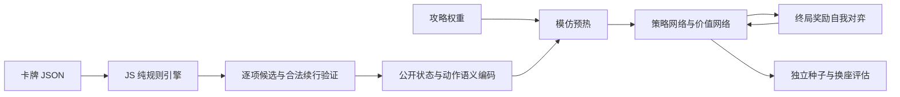

# 姬路城 AI 训练实验

2026-11-11目录修订4修正大名左槽，训练应重新生成数据并使用新的输出目录；旧目录拒绝混用。BGA原始档案仍不能直接加入整局训练；现已接通通过合法性及资源对账的起始选牌策略微调，见 [BGA玩家训练工作流](bga-training-workflow.md)。其余放骰与连锁尚未转换为教师标签。

当前持续运行入口、v3编码与r8得分搜索训练命令见 [持续训练与局面教练](ai-coach.md)。本页保留首轮v1实验方案与路径供追踪；已有旧权重不可直接用于当前编码。

可以开始实验训练。当前环境是 `local-practice-v1`，城堡板块实体编号与资源背面映射、水井资源抽样、跨季拒付处理和轮末新园丁资格仍有练习约定。实验衡量的是该配置下的行为，不能解释为正式基础版最优路线。规则仍以 [RULES.md](RULES.md) 为准，攻略不定义规则。

2026-11-13的r8已采用自身终局分数/80（不封顶）、线性价值头及有限公开机会采样搜索。下文v1的胜负奖励与纯网络贪心描述仅供历史追踪，当前预算、选模和限制以 [AI教练](ai-coach.md) 为准。

## 攻略如何使用

用户提供的 [策略攻略](https://skypray.synology.me/blog/boardgame/white-castle-strategy-guide/) 是 Skypray Huang 翻译 Ateckentrup 的经验文章。文章适合作为探索起点与解释素材；不同摆设、对手和资源时点可能改变结论。

| 攻略观点 | 当前用法 | 后续验证 |
|---|---|---|
| 早期园丁与持续灯笼收益 | 按轮次调整资源、园丁与家臣偏好 | 去掉各项权重，比较胜率和平均分 |
| 武士与城内家臣形成乘分 | 部署候选考虑当前城内人数及训练区系数 | 比较早部署与晚部署的不同开局 |
| 连锁、骰点、左端灯笼 | 对候选作软评分，作为模仿目标 | 用终局胜负更新网络，允许偏离攻略 |
| 清桥影响轮末花园 | 第一、二轮比较双方园丁数量 | 后续加入花园实际收益及对手搜索 |
| Hate Draft | 尚未实现显式对手最佳回应搜索 | 加入双方搜索与资源阻断分析 |

所有先验权重集中在 [ai-heuristic.json](../data/ai-heuristic.json)，可以修改；初版数值是工程起点，不是文章提供的精确数值或经验证的最优值。

## 实现方案



1. **唯一状态转移来源**：Python 不复制规则。`ai-env-server.mjs` 通过标准输入/输出 JSON 行协议调用 `TrainingEnvironment`，该环境复用 `probeLocalAction()` / `applyLocalAction()`。与网页使用同一核心。
2. **分阶段动作**：先选骰子与区域，再选资源、字段、家臣、园丁、武士、影响力支付、兑换、轮末花园。效果排序逐个选下一项，不一次枚举全部排列。`getLegalActions()` 返回当前决策候选，不是所有完整回合组合。
3. **续行验证**：当前候选必须存在一个能完成原子动作的续行；例如先晋升、再谒见的选择不能在后续无金币时卡死。验证仅检查同一动作，不做跨回合搜索。搜索预算用尽会显式报错，不悄悄截断候选。训练步数也有显式上限。
4. **信息与编码**：相对当前玩家编码双方资源、人员、个人牌、灯笼、桥骰、公开城堡、花园、训练面、恩赏槽、当前字段及行动前缀；候选编码其费用、效果、颜色和顺序。网络不接收种子、未来骰子或补牌堆顺序。编码仍是近似表示，不保证涵盖强搜索所需的全部上下文。
5. **模型**：状态编码 MLP 为 `state→64→64`，候选为 `option→64`，二者合并后输出候选 logit。价值头为 `64→32→1`，输出 `[-1,1]`。只在当前有效候选之间 softmax，补齐位置严格屏蔽。
6. **预热**：攻略策略自我对弈，策略头通过交叉熵学习攻略选择，价值头学习这些对局的终局胜负。验证集按整局种子划分，禁止同局不同位置跨入训练与验证两侧。保留验证策略损失最小的快照。模仿准确率只表示学会攻略，不表示棋力提高。
7. **强化学习**：小批 on-policy actor-critic，损失为 `-logπ(a)×(z−V) + 0.5×(V−z)² − 0.01×entropy`。终局 `z` 取胜方 `+1`、负方 `-1`，同分按引擎最终顺序判胜；不把攻略分数作为强化学习奖励。一半对局共享网络自我对弈，另一半对局对固定预热快照、交替座位。每完成一局保存权重、优化器、随机状态与已用种子。
8. **独立评估**：固定新种子，每个开局交换网络方座位，比较随机合法策略、攻略策略与预热模型。报告胜率、平均分、分差及近似区间，不能把极少对局胜率当作显著提升。配对对局相关，区间只供粗略参考。

这一步没有实现 MCTS、PPO或大规模并行。本地练习页后来可以确认后把一席交给冠军模型贪心落子；那不是搜索，也不把策略权重当成胜率。当前小型 CPU 网络足以验证闭环；优先优化规则试走及数据吞吐，再决定是否为显卡安装 CUDA 版本 PyTorch。CUDA 版本不会改变卡牌配置或规则来源。

## 安装与运行

在仓库根目录执行。需要 Node.js 与 Python；本次使用 Python 3.14、PyTorch CPU。没有构建步骤。

```powershell
python -m venv .local/ai-venv
.\.local\ai-venv\Scripts\python.exe -m pip install -r requirements-ai.txt

node scripts/generate-training-data.mjs --games 16 --out .local/ai/guide-v2.jsonl.gz --prefix ai-guide-v2

.\.local\ai-venv\Scripts\python.exe scripts/train-policy.py .local/ai/guide-v2.jsonl.gz --out-dir .local/ai/run-v1 --epochs 12 --selfplay-games 8

.\.local\ai-venv\Scripts\python.exe scripts/evaluate-ai.py .local/ai/run-v1/selfplay.pt --imitation .local/ai/run-v1/imitation.pt --opponents random guide imitation --pairs 4 --out .local/ai/run-v1/evaluation.json
```

数据生成脚本只写完整终局的决策，任一对局失败就退出，不把失败局冒充已完成。数据压缩并遵守写入背压。默认输出不覆盖已有文件；再次实验使用新文件名和输出目录。

数据生成、训练、评估均支持 `--catalog PATH --weights PATH`。目录与先验通过 SHA-256 绑定到数据和权重；编码、动作模型、规则配置不匹配会拒绝加载。调整 [whitecastle-2p.json](../data/whitecastle-2p.json) 后应重新生成数据、训练和评估。各脚本从自身位置定位仓库，不硬编码盘符或分支。

重启后从最后完成一局的检查点继续，使用新的输出目录：

```powershell
.\.local\ai-venv\Scripts\python.exe scripts/train-policy.py .local/ai/guide-v2.jsonl.gz --resume .local/ai/run-v1/selfplay.pt --out-dir .local/ai/run-v2 --selfplay-games 16
```

会恢复模型、优化器、随机状态和固定对手，自动避开已使用的同前缀种子；正在执行但尚未完成的一局不计入检查点。数据生成若中断，重新使用新输出路径生成；不读取未完成文件。

## 产物与验收

首轮结果见 [实验报告](ai-training-results.md)：完整数据、训练、恢复和独立评估均已执行；当前网络仍弱于攻略启发式，不应当作最优策略建议。

- `.local/ai/*.jsonl.gz`：局面、候选、攻略目标和终局标签；不提交。
- `imitation.pt` / `selfplay.pt`：预热与终局奖励模型；不提交。
- `training-report.json` / `selfplay.pt.progress.json`：训练指标与逐局进度。
- `evaluation.json` / `evaluation.last-replay.json`：评估汇总与最后一局可导入网页的 JSON；不提交私人复盘。
- [AI 模块](../src/ai/CHANGELOG.md) 和仓库实验汇总只记录可审查代码与结果，不上传大数据或权重。

```powershell
npm test
npm run check
.\.local\ai-venv\Scripts\python.exe tests/ai_model_test.py
```

重点验收：18 次放骰完整计分、动作可重放、候选维度稳定且无 NaN、家臣死分支被过滤、模型遮罩和梯度有效、验证种子隔离、权重重新载入、配置变更拒绝旧权重。需要网页人工验证时运行 `npm run play`，导入评估复盘；未自动构建。

## 后续研究顺序

用户已确认继续使用当前规则。新增的持续训练、`public-decisions-v2` 编码、历史对手池、冠军选模与本地存档分析见 [持续训练与局面教练](ai-coach.md)。本页的首轮路径和维度属于历史v1实验，运行当前代码请重新生成v2特征数据，旧权重会因版本不同拒绝加载。

继续用消融实验衡量攻略每条假设，观察家臣/武士乘分、园丁时机和资源溢出，而不只追踪训练损失。最后在策略/价值网络上接 MCTS；骰子及未知补牌须按公开信息做机会节点采样，不能利用模拟器内部未来顺序作弊。

参考：[PyTorch 官方文档](https://docs.pytorch.org/docs/stable/index.html)、[AlphaZero 论文](https://arxiv.org/abs/1712.01815)。这里只借用策略/价值、自我对弈和搜索的分层方向，不宣称已经复现 AlphaZero。
