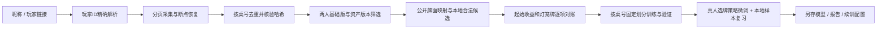

# BGA玩家回放到AI训练工作流

输入玩家精确昵称、ID或个人页/历程链接，采集回放、合并原始库、核对并编码选牌段，再从现有模型微调。产物位于 `.local/`，原有持续训练独立运行。本次接入的是 **R-SETUP-04起始选牌策略**，尚未接通三轮放骰与全部连锁动作。

## 一条命令

在项目根目录的PowerShell运行，不需要编译：

```powershell
# 不传参数会提示输入昵称或链接。
.\scripts\bga-ai.ps1

# 精确昵称、玩家ID、带player/id参数的BGA链接均可。
.\scripts\bga-ai.ps1 -Player 'xiaoxi56'
.\scripts\bga-ai.ps1 -Player '98231251'
.\scripts\bga-ai.ps1 -Player 'https://boardgamearena.com/gamestats?player=98231251&game_id=2242&finished=1'

# 查看下载统计与最近一次训练；不启动训练。
.\scripts\bga-ai.ps1 -Player 'xiaoxi56' -Stage status

# 使用已经下载的快照立即训练；后台爬虫可以继续下载。
.\scripts\bga-ai.ps1 -Player 'xiaoxi56' -Stage train

# 后续同一玩家新完成的游戏：重新分页发现，保留已下载文件。
.\scripts\bga-ai.ps1 -Player 'xiaoxi56' -Refresh
```

默认 `all` 等待采集阶段结束后才转换和训练；已有爬虫持有同目录锁时等待它，不启动第二个。`download` 只下载；`prepare` 只转换当前快照；`train` 从当前快照转换并训练。服务器故障或BGA回放额度上限使采集停止时，`all` 可继续使用已下载快照训练，同时保留 `downloadComplete: false` 和 `crawlError`；未下载局不计入成功数。认证失败则停止流程。采集总进度与某份训练快照的局数可能不同。

Cookie继续使用 `.local/bga-cookie.txt`。已有公开历程中的昵称可离线精确解析；新昵称通过BGA原有玩家搜索入口查询，无法唯一匹配时要求使用玩家链接，绝不按相似名字猜测。链接必须是HTTPS的BGA地址，并明确带玩家ID；仅含桌号的链接不能代表某一玩家。

需要 `.local/ai-venv`、Python/PyTorch、Node和已有修订4本地教师数据。默认从当前持续训练的冠军检查点读取初始权重，另存本次微调模型；冠军未配置时使用预热模型。不会把未评估的真人模仿结果自动晋升成冠军。

## 数据如何核对



- 默认合并 `.local/bga-database/` 中已有玩家库，教师仅包括这些目录对应的目标玩家。对手的动作只用来还原状态，不默认作为教师。相同桌号跨玩家只保留一份，整局属于同一分区。
- 只支持当前字典对应资产 `260825-0951`、两人基础版和已知普通摆设，三项扩展必须明确停用。旧格式缺桌面选项、多人、未知版本或不支持的摆设保留原始资料并列明排除原因。
- 开局已公开的城堡牌、骰色槽、花园、大名、训练面、水井和三组起始牌全部映射到本地ID。起始行动的两个实体副本保留身份。
- 两位玩家的选牌顺序、资源卡与行动卡的成对实例、金币/印章/三资源变化和灯笼牌必须与本地选牌规则完全一致。选牌段缺失、含撤销或对账失败则整段排除，后续放骰段不作为标签。
- 任意资源收益展开为合法的单位资源序列；这是同收益的本地表示，不声称还原BGA按钮的点击顺序。
- 只读取 `endDraft` 之前的事件作为决策证据。未来补牌、后续骰子、比分、对手名字和桌号不进入特征。原始回放仍标记不可直接训练，生成的分阶段训练文件有独立格式 `bga-verified-draft-v1`。
- 新数据使用现有 `public-decisions-v2` 和 `factored-engine-v1`，不改变编码哈希或复用旧目录数据。BGA样本的 `z=0`、`valueWeight=0`：只学习选牌，不用不兼容的全局结局监督本地价值头。旧的整局训练入口会拒绝该部分数据，必须使用配套微调器。

## 训练与产物

每个批次最多8条真人决策和24条本地教师决策，默认4个epoch。真人样本按桌号哈希固定留出约四分之一；增添玩家或回放不会改变已有桌号分区。同一桌的对手、不同玩家视角及资源子选择不会跨分区。若基线权重已在验证桌号上训练，拒绝继续，须使用未见过这些验证桌号的基线。

每个批次独立写到 `.local/ai/bga-runs/<时间戳-标识>/`：

| 文件 | 内容 |
|---|---|
| `bga-draft.jsonl.gz` | 本地公开特征、合法候选、真人目标、来源和对账标记 |
| `bga-draft.jsonl.gz.report.json` | 接纳/排除桌号、原因、快照来源、转换器和数据哈希 |
| `workflow.json` | 流程阶段及各产物路径 |
| `model/imitation.pt` | 可由现有模型加载器读取的微调检查点 |
| `model/training-report.json` | 训练/验证分区、训练前后指标、选定epoch、未评估棋力标记 |
| `model/next-loop-config.json` | 从该模型启动一个独立持续训练目录的配置 |

最优快照按BGA验证策略损失选择；验证结果用于选模，不是最终独立测试。默认包含训练前基线，若微调未改善则保存基线。损失或模仿准确率都不是动作胜率，也不证明全局棋力提高。

若要从产物继续本地自我对弈，在新的输出目录运行（将示例标识替换为实际批次）：

```powershell
.\scripts\train-ai.ps1 -Config '.local/ai/bga-runs/<批次>/model/next-loop-config.json' `
  -OutputDirectory '.local/ai/bga-runs/<批次>/continuous'
```

不要与旧循环共用输出目录。当前工作流已完成微调，不会自动再启动一个无限自我对弈进程。

底层可单独调用，所有路径由脚本位置或参数推导：

```powershell
.\.local\ai-venv\Scripts\python.exe scripts/bga-workflow.py '98231251' --stage train --epochs 4
node scripts/prepare-bga-training.mjs --out .local/ai/my-bga-draft.jsonl.gz --players 98231251
.\.local\ai-venv\Scripts\python.exe scripts/train-bga.py .local/ai/my-bga-draft.jsonl.gz `
  --checkpoint .local/ai/continuous-r4/initial/imitation.pt --out-dir .local/ai/my-bga-model
```

跨分支复制需保留相同仓库目录结构中的 `scripts/`、`src/`、`data/`；Cookie、环境、原始库、教师文件和权重在目标副本单独配置。PowerShell入口使用自身位置寻找配套Python脚本，运行目录不限于仓库根目录。环境相关的输入库、模型和输出路径也可通过Python CLI指定。

## 2026-11-11实测

首次快照共有186局已下载回放，93局通过选牌核对，生成165条目标玩家决策；其余含32局多人、26局开局状态不适用、6局不支持的设置、29局选牌撤销。完成4轮真实微调，固定验证39条决策的策略损失由1.2811降到1.1811，模仿Top1保持41.0%；本地教师验证Top1由80.29%变为80.06%。这是兼容性及训练闭环验证，尚未进行新模型棋力对战评估。

后续要把放骰、家臣晋升和连锁全部接入，需要逐动作重建公开状态、归并撤销、核对补牌/轮间骰子及合法候选；当前不能宣传为已经学习了完整高手对局。

实际检查：18项AI/BGA相关Node测试、26项Python测试（采集15、BGA训练/工作流5、AI模型3、AI循环3）、项目导入/文案/文档链接及44份原图指纹通过。未编译或构建；命令行工作流无需构建。推荐人工对照原始网页选牌与转换报告，再用新种子换座对战评估微调模型。
